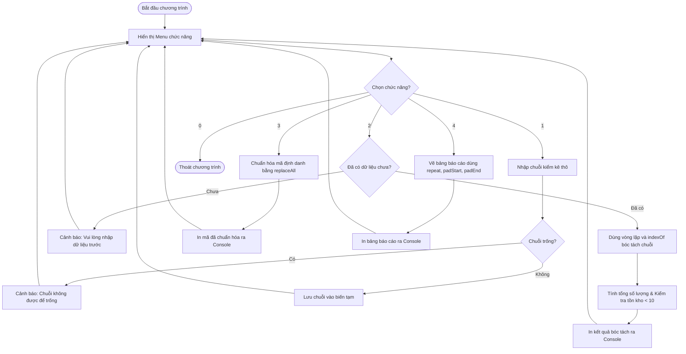

# BÁO CÁO BÀI TẬP: XÂY DỰNG HỆ THỐNG XỬ LÝ CHUỖI DỮ LIỆU KIỂM KÊ VÀ QUẢN TRỊ KHO THỂ HÌNH

> 👤 **Học viên:** Hoàng Công Dũng | **Mã SV:** PTIT-HCM-009
> 🏫 **Môn học:** it103b-rl-HoangCongDung

---

## 📊 Sơ đồ thiết kế hệ thống (Flowchart)

> 💡 *Sơ đồ dưới đây được render tự động trực tiếp trên GitHub bằng Mermaid. Bạn cũng có thể tải file **`bt4.drawio`** trong repository này để mở và chỉnh sửa trực tiếp trên [Draw.io (diagrams.net)](https://app.diagrams.net).* 

---

## 1. Mục tiêu và Phân tích bài toán

Bài tập này yêu cầu tự tay code thuật toán bóc tách chuỗi dữ liệu thô từ máy quét mã vạch kiểm kê kho thiết bị thể hình mà không được phép sử dụng các hàm mảng nâng cao như map, filter hay reduce. Toàn bộ logic phải dựa trên vòng lặp cơ bản, phương thức indexOf, slice và replaceAll.

Dữ liệu đầu vào từ máy quét có dạng 'DUMBBELL:20#BARBELL:15#TREADMILL:05#MAT:40'. Nhiệm vụ của mình là phải xử lý chuỗi này thành các thông tin có nghĩa, tính tổng số lượng thiết bị, chuẩn hóa mã định danh theo quy ước kho hàng và vẽ bảng báo cáo thẳng hàng trực quan ngay trên Console.

- Sử dụng thuần túy vòng lặp và indexOf để cắt chuỗi theo ký tự phân cách '#' và ':'
- Áp dụng phương thức replaceAll để đổi tiền tố mã thiết bị sang chuẩn mới
- Thiết lập cơ chế cảnh báo tồn kho tự động cho các thiết bị có số lượng dưới 10
- Sử dụng padEnd và padStart để căn chỉnh bảng báo cáo đẹp mắt

## 2. Thuật toán bóc tách chuỗi và Quy tắc nghiệp vụ

Để giải quyết bài toán không dùng mảng nâng cao, mình thiết kế thuật toán duyệt qua từng ký tự hoặc dùng indexOf để tìm vị trí của dấu ':' và '#'. Cụ thể, vòng lặp sẽ tìm vị trí dấu ':' để tách lấy tên thiết bị, sau đó tìm dấu '#' tiếp theo để lấy chuỗi số lượng.

Quy tắc cảnh báo tồn kho được cài đặt ngay trong quá trình duyệt chuỗi: Nếu số lượng chuyển sang kiểu số mà nhỏ hơn 10, hệ thống sẽ tự động gắn nhãn '[CẦN BẢO TRÌ/BỔ SUNG]' để nhân viên kho dễ dàng nắm bắt tình hình thiết bị.

- Xử lý bẫy dữ liệu: Kiểm tra chuỗi rỗng trước khi thực hiện bóc tách để tránh lỗi thời gian chạy.
- Chuẩn hóa mã định danh: Thay thế chuỗi 'DUMBBELL' thành 'EQ-DB', 'BARBELL' thành 'EQ-BB', 'TREADMILL' thành 'EQ-TM', và 'MAT' thành 'EQ-MT'.
- Định dạng bảng: Dùng .padEnd(15, ' ') cho tên thiết bị và .padStart(10, ' ') cho số lượng để đảm bảo các cột luôn thẳng hàng.

## 3. Bảng đặc tả chi tiết các chức năng hệ thống

Dưới đây là bảng phân tích chi tiết các chức năng có trong Menu chương trình quản lý kho:

| Chức năng | Tên thao tác | Mô tả kỹ thuật xử lý | Kết quả đầu ra |
| --- | --- | --- | --- |
| 1 | Nhập chuỗi thô | Nhận chuỗi từ người dùng, kiểm tra điều kiện không được để trống | Lưu chuỗi vào biến toàn cục của module |
| 2 | Bóc tách & Đếm | Dùng vòng lặp while, indexOf, slice để cắt tên và số lượng thiết bị | Hiển thị tổng số lượng và gắn cờ cảnh báo tồn kho |
| 3 | Chuẩn hóa mã | Sử dụng phương thức replaceAll để thay thế các từ khóa thiết bị | In ra chuỗi mã định danh mới đã được quy hoạch |
| 4 | Xuất báo cáo | Sử dụng .repeat() vẽ khung, .padEnd() và .padStart() căn lề cột | In bảng báo cáo kiểm kê chuyên nghiệp ra Console |

## 4. Hướng dẫn chạy chương trình và Kiểm thử

File mã nguồn được đặt tên chính xác là 'practice_gym_inventory.js' và được đẩy lên GitHub Organization 'it103b-rl-HoangCongDung' đúng theo quy định.

Các trường hợp kiểm thử (Test Cases) đã được bổ sung trực tiếp vào phần comment đầu file code để giảng viên tiện chấm điểm và kiểm tra.

---

## 📁 Danh sách tệp tin nộp bài trong Repository
- 📝 `bt4.docx`: Báo cáo tài liệu phân tích nghiệp vụ hoàn chỉnh.
- 🎨 `bt4.drawio`: File thiết kế sơ đồ chuẩn theo quy định đề bài (mở trực tiếp bằng [Draw.io](https://app.diagrams.net) hoặc Lucidchart).
- 💻 `practice_gym_inventory.js`: Mã nguồn chương trình.
